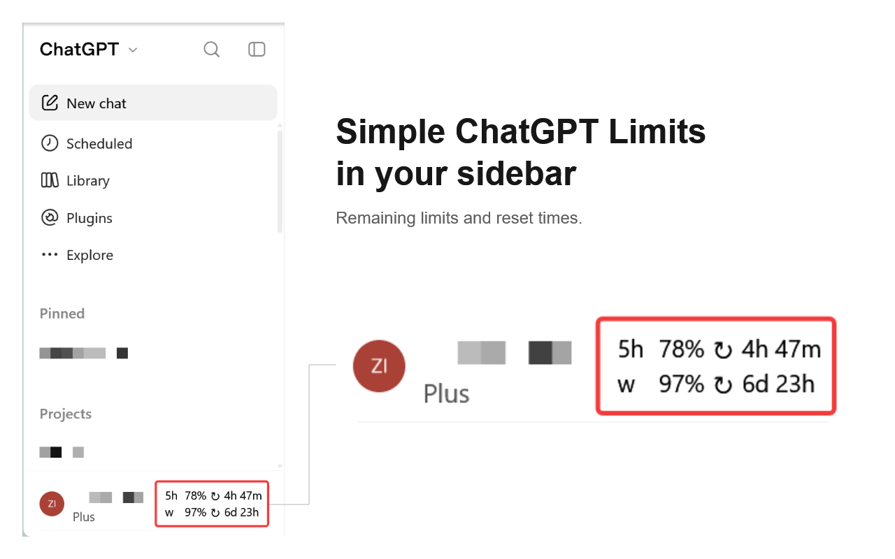

# Codex sidebar usage

Shows your remaining 5-hour and weekly Codex limits beside your ChatGPT profile.

## Chrome extension

1. Open `chrome://extensions` and turn on **Developer mode**.
2. Click **Load unpacked** and select this folder.
3. Reload ChatGPT and expand the sidebar.

## Userscript

With Tampermonkey or Violentmonkey installed, [install the script](https://raw.githubusercontent.com/zizhengwu/codex-limits-in-sidebar/main/codex-usage.user.js) and reload ChatGPT. If the link opens as text, paste it into a new script in your userscript manager.

[Privacy](PRIVACY.md) · [Report a bug](https://github.com/zizhengwu/codex-limits-in-sidebar/issues)
